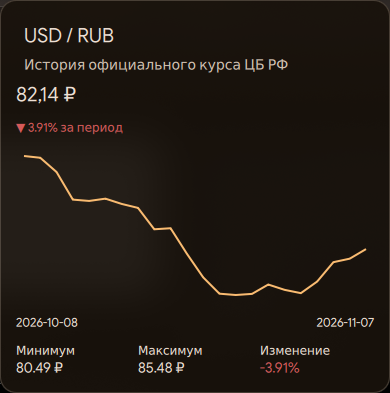

# USD/RUB Rate — DMS Widget

A widget for DankMaterialShell (DMS) displaying the official USD/RUB exchange rate published by the Central Bank of Russia.



## Features

- Current official USD/RUB exchange rate.
- Periodic rate updates.
- Direction-of-change indicator.
- Historical exchange-rate data.
- Historical chart and statistics:
  - Minimum rate
  - Maximum rate
  - Percentage change

## Installation

Clone the repository into your DMS plugins directory:

```bash
git clone https://github.com/pclect/dms-usd-rub-widget.git ~/.config/dms/plugins/USD_RUB
```

Then open DMS settings, find the plugin and add the widget to your panel.

The exact loading procedure may depend on your DMS version.

## Data source

Exchange-rate data is provided by the Central Bank of Russia through:

https://www.cbr-xml-daily.ru/

## License

This project is licensed under the GNU General Public License v3.0 or later (GPL-3.0-or-later). See [LICENSE](LICENSE).

---

# USD/RUB Rate — виджет для DMS

Виджет для DankMaterialShell (DMS), отображающий официальный курс доллара США к российскому рублю, публикуемый Центральным банком Российской Федерации.


## Возможности

- Отображение текущего официального курса USD/RUB.
- Периодическое обновление курса.
- Индикация направления изменения курса.
- История изменения курса.
- График и статистика:
  - Минимальный курс
  - Максимальный курс
  - Изменение в процентах

## Установка

Склонируйте репозиторий в каталог пользовательских плагинов DMS:

```bash
git clone https://github.com/pclect/dms-usd-rub-widget.git ~/.config/dms/plugins/USD_RUB
```

Затем откройте настройки DMS, найдите плагин и добавьте виджет на панель.

Точный порядок загрузки может зависеть от версии DMS.

## Источник данных

Данные об официальном курсе предоставляет Центральный банк Российской Федерации через сервис:

https://www.cbr-xml-daily.ru/

## Лицензия

Проект распространяется на условиях GNU General Public License версии 3 или любой более поздней версии (GPL-3.0-or-later). Подробности — в файле [LICENSE](LICENSE).
